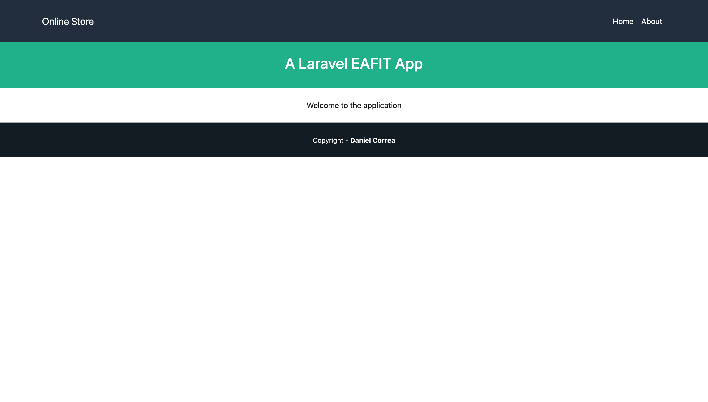
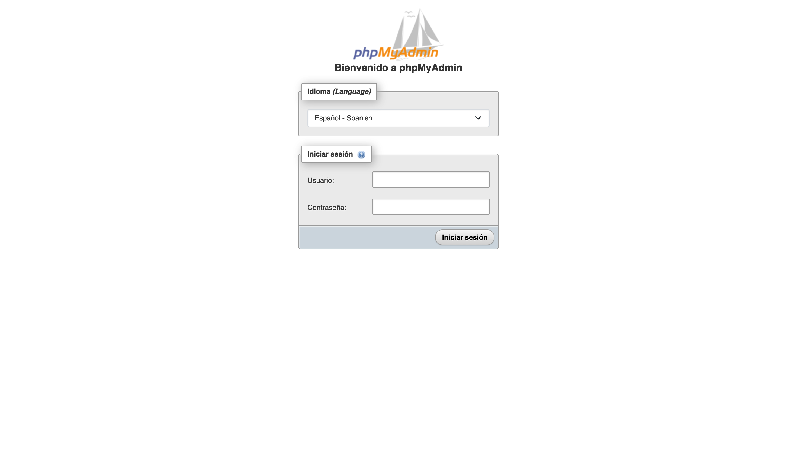
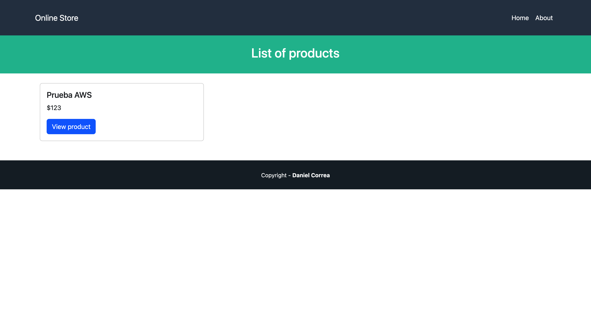
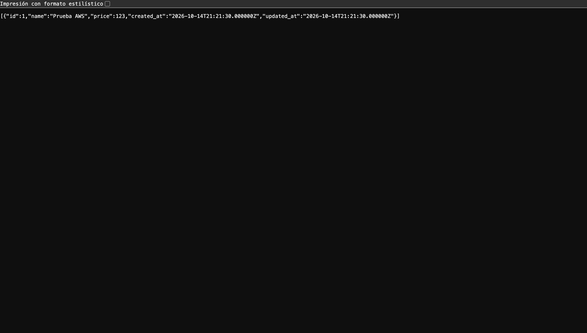
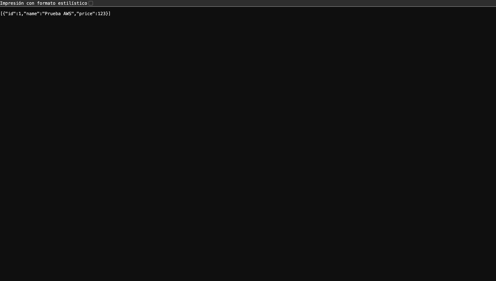
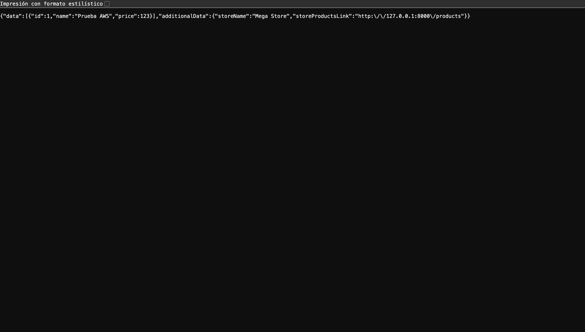
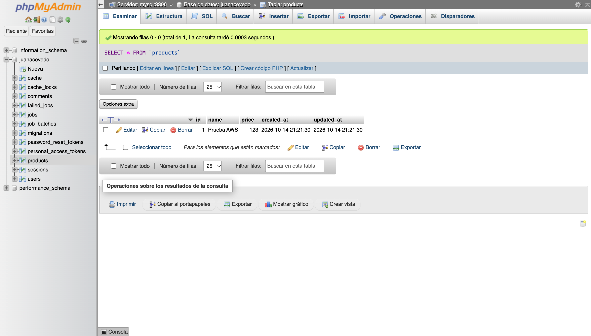

# Tutorial 05: Laravel, MySQL y phpMyAdmin con Docker en AWS

Despliegue individual del proyecto acumulado de los tutoriales (carpeta [`Tutorial-04`](../Tutorial-04)) en la instancia EC2 compartida del grupo **Los de al fondo (arqui)**, siguiendo el enunciado [`tutorial_laravel_aws_compartido.md`](tutorial_laravel_aws_compartido.md).

## Datos del despliegue

| Dato | Valor |
|---|---|
| Estudiante | Juan José Acevedo Otálvaro |
| Instancia | `i-0322888aeb5f93ab4`, t3.micro spot, Amazon Linux 2023, us-east-1c |
| Integrante | 2 |
| `STUDENT_ID` | `juan-acevedo` |
| Imagen | `laravel-juan-acevedo:1.0` |
| Base y usuario MySQL | `juanacevedo` |
| Laravel | `http://<IP>:8082` |
| phpMyAdmin | `http://<IP>:9082` |
| MySQL en el host | `127.0.0.1:33062` (no expuesto a internet) |
| IP pública usada en las evidencias | `18.232.149.171` |

La IP pública cambia cada vez que la instancia se enciende desde la herramienta del docente, por eso las URL se dan con `<IP>`. Las evidencias se tomaron con `18.232.149.171`.

## Archivos Docker

Están en la raíz del proyecto Laravel, junto a `artisan` y `composer.json`, tal como pide el enunciado:

- [`Dockerfile`](../Tutorial-04/Dockerfile): PHP 8.4 con Apache, solo `pdo_mysql`, sin Node ni Vite.
- [`.dockerignore`](../Tutorial-04/.dockerignore): excluye `.env`, `vendor`, llaves `.pem` y archivos temporales.
- [`compose.infra.yaml`](../Tutorial-04/compose.infra.yaml): MySQL 8.4 y phpMyAdmin 5.2 en la red `juan-acevedo-net`.
- [`compose.app.yaml`](../Tutorial-04/compose.app.yaml): la aplicación Laravel, conectada a la red externa `juan-acevedo-net`.

El `.env` del servidor no está en el repositorio; contiene `APP_KEY` y las contraseñas generadas con `openssl rand -hex 24`.

## Procedimiento

1. Encender la instancia desde la herramienta del docente y conectarse:

   ```bash
   ssh -i ~/.ssh/students.pem ec2-user@<IP>
   ```

2. Revisar herramientas. Docker 25 y Compose v2.40.3 ya estaban instalados, junto con git, nano y openssl, así que se omitieron los pasos 2 y 3 del enunciado. El integrante 1 (Juan Esteban Peña) ya tenía sus contenedores en 8081, 9081 y 33061.

3. Clonar el repositorio en la carpeta individual:

   ```bash
   mkdir -p ~/students/juan-acevedo && cd ~/students/juan-acevedo
   git clone https://github.com/jjacevedo/jjacevedoo-Topicos-Software.git app
   cd app/Tutoriales/Tutorial-04
   ```

4. Crear `.env` con los valores del integrante 2 y `chmod 600 .env`.

5. Construir la imagen y generar la llave:

   ```bash
   docker build -t laravel-juan-acevedo:1.0 .
   docker run --rm laravel-juan-acevedo:1.0 php artisan key:generate --show
   ```

6. Levantar MySQL y phpMyAdmin:

   ```bash
   docker compose -f compose.infra.yaml config --quiet
   docker compose -f compose.infra.yaml up -d --wait --wait-timeout 240
   ```

7. Crear la base y el usuario de Laravel con el SQL del enunciado (ejecutado desde el contenedor de MySQL como root):

   ```sql
   CREATE DATABASE IF NOT EXISTS `juanacevedo` CHARACTER SET utf8mb4 COLLATE utf8mb4_unicode_ci;
   CREATE USER IF NOT EXISTS 'juanacevedo'@'%' IDENTIFIED BY '<DB_PASSWORD>';
   GRANT ALL PRIVILEGES ON `juanacevedo`.* TO 'juanacevedo'@'%';
   ```

8. Levantar Laravel y migrar:

   ```bash
   docker compose -f compose.app.yaml up -d
   docker compose -f compose.app.yaml exec --user www-data app php artisan migrate --force
   ```

## Salidas relevantes

Build de la imagen:

```text
[+] Building 8.2s (14/14) FINISHED
 => [stage-0 6/7] RUN composer install --no-dev --prefer-dist --no-interaction --optimize-autoloader  5.1s
 => => naming to docker.io/library/laravel-juan-acevedo:1.0
```

Infraestructura:

```text
 ✔ Network juan-acevedo-net                   Created
 ✔ Volume juan-acevedo-infra_mysql_data       Created
 ✔ Container juan-acevedo-infra-mysql-1       Healthy
 ✔ Container juan-acevedo-infra-phpmyadmin-1  Healthy
```

Acceso del usuario de la aplicación a su base:

```text
Database
information_schema
juanacevedo
performance_schema
```

Migraciones:

```text
  0001_01_01_000000_create_users_table .................................. DONE
  0001_01_01_000001_create_cache_table .................................. DONE
  0001_01_01_000002_create_jobs_table ................................... DONE
  2026_08_19_132858_create_products_table ............................... DONE
  2026_08_24_202706_create_comments_table ............................... DONE
  2026_10_14_203627_create_personal_access_tokens_table ................. DONE
```

## Evidencias

Aplicación Laravel en el puerto 8082:



phpMyAdmin propio en el puerto 9082:



Producto `Prueba AWS` con precio `123` creado desde `/products/create` y listado en `/products`:



El mismo producto en las tres versiones del API REST del Tutorial 04:







Ingreso a phpMyAdmin con el usuario `juanacevedo`; la tabla `products` contiene el registro guardado por Laravel:



### Persistencia después de `down` y `up` sin `-v`

```bash
docker compose -f compose.app.yaml down
docker compose -f compose.infra.yaml down
docker compose -f compose.infra.yaml up -d --wait --wait-timeout 240
docker compose -f compose.app.yaml up -d
```

Los tres contenedores se crearon de nuevo a las 21:24 UTC y el producto, creado a las 21:21 UTC, sigue en la base:

```text
Wed Oct 14 21:29:03 UTC 2026
NAMES                             CONTAINER ID   CREATED AT                      STATUS
juan-acevedo-app-app-1            969fd94e8986   2026-10-14 21:24:59 +0000 UTC   Up 4 minutes
juan-acevedo-infra-phpmyadmin-1   84b7caf7ab57   2026-10-14 21:24:50 +0000 UTC   Up 4 minutes
juan-acevedo-infra-mysql-1        d2733681c095   2026-10-14 21:24:50 +0000 UTC   Up 4 minutes (healthy)
[{"id":1,"name":"Prueba AWS","price":123,"created_at":"2026-10-14T21:21:30.000000Z","updated_at":"2026-10-14T21:21:30.000000Z"}]
```

### Coexistencia con el despliegue del integrante 1

```text
NAMES                             STATUS                        PORTS
juan-acevedo-app-app-1            Up About a minute             0.0.0.0:8082->80/tcp
juan-acevedo-infra-phpmyadmin-1   Up About a minute             0.0.0.0:9082->80/tcp
juan-acevedo-infra-mysql-1        Up About a minute (healthy)   127.0.0.1:33062->3306/tcp
juan-pena-app-app-1               Up 14 minutes                 0.0.0.0:8081->80/tcp
juan-pena-infra-phpmyadmin-1      Up 14 minutes                 0.0.0.0:9081->80/tcp
juan-pena-infra-mysql-1           Up 14 minutes (healthy)       127.0.0.1:33061->3306/tcp

NAME                              MEM USAGE / LIMIT
juan-acevedo-app-app-1            41.38MiB / 913.2MiB
juan-acevedo-infra-phpmyadmin-1   13.43MiB / 913.2MiB
juan-acevedo-infra-mysql-1        188.2MiB / 913.2MiB
juan-pena-app-app-1               12.05MiB / 913.2MiB
juan-pena-infra-phpmyadmin-1      12.1MiB / 913.2MiB
juan-pena-infra-mysql-1           195.8MiB / 913.2MiB

               total        used        free      shared  buff/cache   available
Mem:             913         664          69          27         178          89
```

## Respuestas

**1. ¿Qué diferencia hay entre imagen, contenedor y volumen?**
La imagen es una plantilla de solo lectura con el sistema base, PHP, Apache, el código y las dependencias; se construye una vez con `docker build`. El contenedor es una instancia en ejecución de esa imagen, con su propio proceso, red y capa de escritura temporal; se puede borrar y crear de nuevo sin afectar la imagen. El volumen es almacenamiento administrado por Docker que vive fuera del ciclo de vida del contenedor; aquí guarda los datos de MySQL (`juan-acevedo-infra_mysql_data`) y el `storage` de Laravel, por eso los datos sobrevivieron al `down` y `up`.

**2. ¿Por qué se repite el puerto interno 3306, pero cada puerto publicado debe ser distinto?**
Cada contenedor tiene su propio espacio de red, así que cada MySQL puede escuchar en su 3306 sin chocar con los demás. Los puertos publicados pertenecen al host, que es uno solo, y dos procesos no pueden escuchar en el mismo puerto del host. Por eso el de Peña se publica en 33061 y el mío en 33062, aunque ambos usan 3306 por dentro.

**3. ¿Por qué `DB_HOST` es `mysql` y no `localhost`?**
Dentro del contenedor de Laravel, `localhost` es el propio contenedor de Laravel, donde no hay ningún MySQL. Docker incluye un DNS interno en las redes definidas por el usuario que resuelve el nombre del servicio (`mysql`) a la IP del contenedor de MySQL dentro de `juan-acevedo-net`.

**4. ¿Cómo conectan sus dos proyectos Compose?**
Por una red compartida. `compose.infra.yaml` crea la red `juan-acevedo-net` y conecta MySQL y phpMyAdmin a ella. `compose.app.yaml` declara esa misma red como `external: true`, así que no la crea, sino que conecta el contenedor de Laravel a la red existente. Por eso la infraestructura debe estar arriba antes de la aplicación: `depends_on` no funciona entre dos proyectos Compose distintos.

**5. ¿Qué diferencia hay entre GitHub y Docker Hub?**
GitHub guarda y versiona código fuente: el `Dockerfile`, los archivos Compose y el proyecto Laravel. Docker Hub es un registro de imágenes ya construidas, listas para descargar con `docker pull` y ejecutar sin compilar. En este despliegue el servidor clonó el código de GitHub y construyó la imagen localmente; con Docker Hub se construiría en otra máquina y el servidor solo descargaría el resultado.

**6. ¿Por qué importa la arquitectura de una imagen?**
Una imagen contiene binarios compilados para un tipo de procesador. La instancia es `x86_64` (`linux/amd64`), mientras que un Mac con Apple Silicon es `arm64`. Si se construye una imagen en un Mac y se ejecuta en la instancia sin especificar `--platform linux/amd64`, falla con errores como `exec format error`. Construir en la misma instancia, como se hizo aquí, evita el problema.

**7. ¿Qué ocurre si elimina su volumen MySQL?**
Se pierden todos los datos: la base `juanacevedo`, el usuario, las tablas y el producto guardado. Al levantar de nuevo la infraestructura, MySQL encontraría un volumen vacío y se inicializaría desde cero con `MYSQL_ROOT_PASSWORD`, así que habría que crear otra vez la base, el usuario y correr las migraciones. Por eso se usa `down` sin `-v`.

## Observaciones

- **Memoria de la instancia.** Con dos despliegues activos quedan 89 MiB disponibles de 913 MiB, sin swap. Cada MySQL usa unos 190 MiB, así que un tercer despliegue completo en esta misma instancia probablemente agotaría la memoria. El enunciado advierte que validar un despliegue no garantiza que la instancia sostenga los nueve contenedores del grupo.
- **IP dinámica.** Al encender la instancia la IP pública cambia. `restart: unless-stopped` levanta los contenedores solos, pero `APP_URL` debe actualizarse en el `.env` y aplicarse con `docker compose -f compose.app.yaml up -d`.
- **Build rápido.** El build tardó 8.2 s porque las capas base ya estaban en caché por el despliegue del integrante 1, que usa el mismo `Dockerfile`.
